<p align="center">
  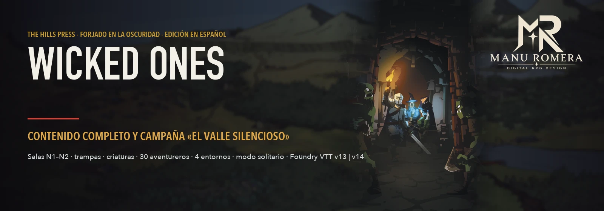
</p>

<p align="center">
  <a href="https://github.com/ManuRomera"></a>
  <a href="https://github.com/ManuRomera/mr-wicked-ones-es/releases/latest"></a>
  
  <a href="https://github.com/ManuRomera/mr-wicked-ones-es/releases"></a>
  
  
  <a href="LICENSE"></a>
</p>

<h3 align="center">Lo que le falta al sistema <em>Wicked Ones</em> en Foundry VTT: campaña, compendios, arte propio, ficha compacta, modo oscuro y reglas automatizadas.</h3>

> [!IMPORTANT]
> Este módulo amplía el sistema [**Wicked Ones**](https://foundryvtt.com/packages/wicked-ones) y su traducción [**Wicked Ones (Español)**](https://foundryvtt.com/packages/wicked-ones-esp) con **Babele**. Para la barra del Director de Juego (escenas, música, relojes) instala también [**MR- Dirección**](https://github.com/ManuRomera/mr-direccion).

<p align="center">
  <a href="https://github.com/ManuRomera/mr-wicked-ones-es/releases/latest/download/module.zip"><strong>⬇️ Descargar</strong></a>
  ·
  <a href="#-instalar"><strong>⚡ Instalar</strong></a>
  ·
  <a href="#-qué-trae"><strong>📦 Contenido</strong></a>
  ·
  <a href="#-mejoras-de-juego"><strong>🛠️ Mejoras</strong></a>
</p>

---

## 🏰 La premisa

Sois **monstruos** —orcos, goblins, kóbolds, demonios, serpientes— que excavan su guarida bajo la montaña mientras los «héroes» de la superficie os persiguen. Este módulo trae el contenido que el sistema no incluye, ordenado y con arte propio en el estilo gráfico del juego.

<p align="center">
  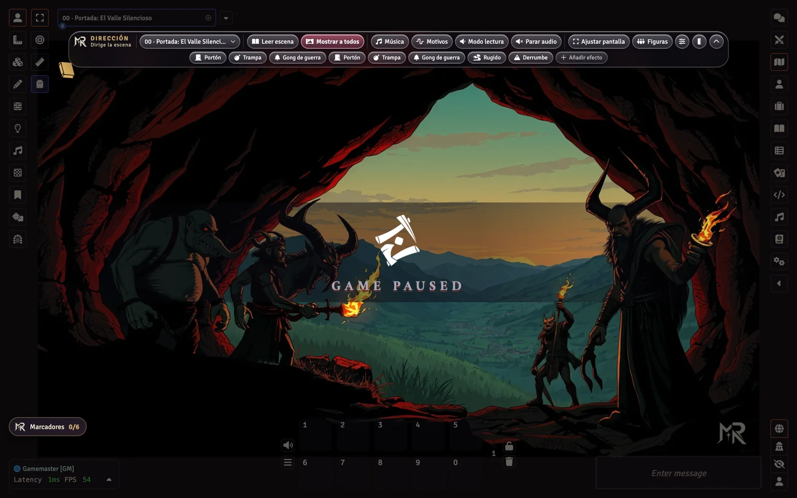
</p>

## 📦 Qué trae

Todo está en carpetas, y los compendios del sistema quedan separados de los de este módulo.

| Compendio | Contenido |
|---|---|
| **Campaña** | «El Valle Silencioso»: 21 escenas ilustradas y mapas, con **lectura**, **música** y **efectos**; listas de reproducción; macros. |
| **Libro y referencia** | Diarios por capítulos, «Empieza aquí» y las lecturas de escena. |
| **Tablas** | Botín N1–N3, incursiones, calamidades, nombres y el modo solitario «El Gran Malo Malvado». |
| **Aventureros y ayudantes** | 30 aventureros con sus 6 movimientos y 36 ayudantes, cada uno con retrato. |
| **Salas, trampas, trucos, portones y criaturas** | 130 elementos de guarida con icono propio. |
| **Equipo** | 165 objetos: arsenal, 36 mejunjes, 36 artilugios, 36 pociones y 36 reliquias, todos con icono. |
| **Personajes · Esbirros · Facciones · Grupos** | 6 pregenerados, 6 manadas, 48 facciones de 4 entornos y grupos rivales, con retrato, token y figura de cuerpo entero. |

<p align="center">
  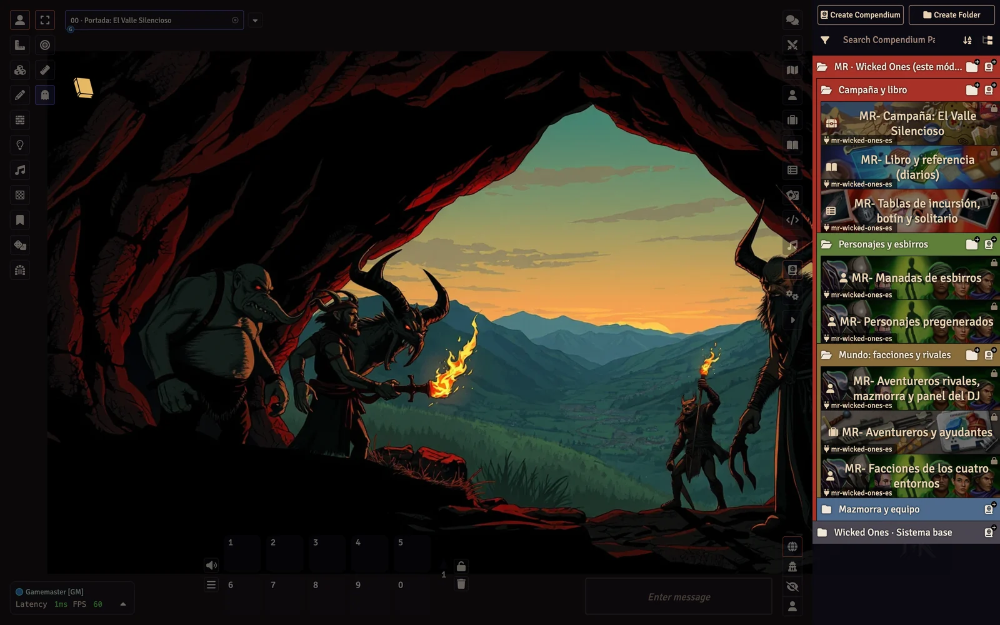
</p>

## 🛠️ Mejoras de juego

### Crear un monstruo paso a paso (o al azar)
El **creador** sigue el orden del manual: raza, vocación, capacidad de vocación, reparto de acciones (3/2/2/1/1), impulso oscuro, juerga, equipo y suministros con su defensa, y nombre. Cada paso tiene su botón **«Al azar»** y hay un **«Todo al azar»** para tener un monstruo listo en diez segundos. Se abre desde el directorio de Actores («Crear monstruo»), desde la barra de la hoja (para rehacer un personaje) o con `api.abrirCreador()`.

### Constructor de mazmorras al estilo *Dungeon Keeper*
Un **constructor interactivo** (botón de la barra de escena) para excavar la mazmorra en la propia escena. **Excavas** túneles, **construyes salas** de diez tipos con solo arrastrar un rectángulo (o pulsar una celda): la sala **se crea sola, ajustada al espacio**, y si es menor que su mínimo crece hasta él. Las salas pueden tener **cualquier forma** (óvalo, L, cruz o pintada celda a celda). Se dibuja en vista 3/4 con arte propio (cofres, yunques, hornos, altares, tronos, armeros, jaulas…) y **cada tipo tiene su plano**: el trono o el altar al fondo, **la alfombra siguiendo el eje de la puerta** (horizontal o vertical), pilares y estatuas en las salas grandes y más oro en el tesoro cuanto más sube el nivel de la mazmorra. Los **pasillos llevan antorchas** de frente o de perfil según corran en horizontal o vertical, y unos **duendes diminutos** recorren la mazmorra picando y trabajando: su número crece con el nivel de la mazmorra y el DJ regula la densidad (se apagan en Ajustes). Con el **látigo** (como en *Dungeon Keeper*) los azuzas: trabajan al doble de velocidad un rato. Hay **efectos de sonido** (cavar, construir, puertas, trampas, látigo) y **ambiente** de cueva, con interruptor y volumen en el propio panel. Puedes colocar las **trampas y trucos del manual** (mecanismo, detonador y nivel de sus tablas), activarlos con la tirada del manual y marcarlos como descubiertos. Los **tokens** pasan a **media casilla** en las escenas de mazmorra para quedar a la escala de las salas (ajuste).

Sigue las **reglas del manual** (apagables en Ajustes): construir y excavar son proyectos de descanso de la fase de acecho, así que el constructor lleva la cuenta de las **acciones de descanso** (una por PJ más los duendes; el DJ suma las de esbirros pagados y repone con «Nueva fase de acecho», o solo al pasar el panel del DJ a la fase 1). Túnel largo y sala menor, nivel 1; guarida y prisión, nivel 2; las **salas de nivel 3** piden la temática y los materiales de la **ficha de la mazmorra** (y solo una de otra temática). El DJ puede **conceder acciones extra**, y los **relojes de proyecto** que llenen los PJ se convierten en acciones de obra (los que hablan de construir se aplican solos). El panel lo explica todo y avisa del porqué de cada «no». El manual no fija medidas: los mínimos son del módulo.

Lo que Foundry ya hace, lo hace Foundry: **los muros y las puertas son `Wall` nativos** (visión, colisión y puertas que se abren) y las salas de 3×3 o más —y las importantes: santuario, tesoro y forja— reciben una **luz con animación de antorcha**. Cualquier jugador puede construir (el DJ puede desactivarlo en Configuración): sus órdenes viajan por socket al DJ, que levanta la obra.

<p align="center">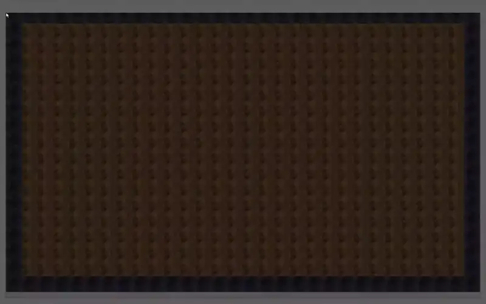<br><sub>Construir la mazmorra desde cero y dar latigazos a los duendes · Building a dungeon from scratch and whipping the minions · <a href="docs/video/constructor-demo.mp4">MP4</a></sub></p>
<p align="center">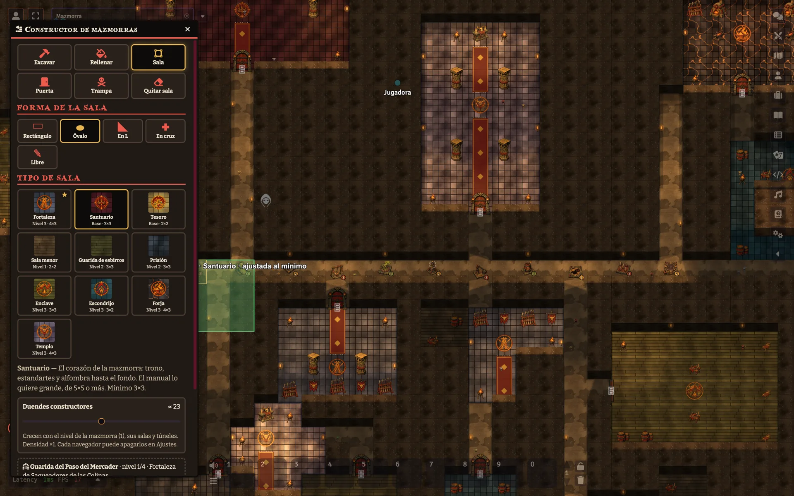</p>
<p align="center">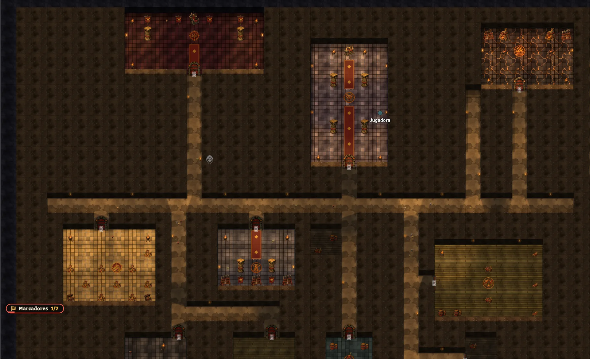</p>

### Hitos y relojes de la campaña, sin depender de nada más
Una píldora **«Marcadores»** (arrastrable; **Alt+M**) abre un panel con los **hitos** de la campaña y los **relojes**. El DJ lo ve todo y avanza los relojes casilla a casilla; la mesa solo ve lo público. Desde **«Gestionar hitos y relojes»** (o el panel del DJ) se **añaden, editan y quitan**: hitos **públicos o secretos**, relojes **visibles u ocultos**, **aviso a la mesa** al avanzar con una **frase de sabor por casilla** (o propia con Mayús + clic). Con [MR- Dirección](https://github.com/ManuRomera/mr-direccion) activo, este control **sustituye al suyo y comparte sus datos** (lee y escribe sus hitos, relojes y progreso), así que ambos módulos siempre ven lo mismo.

<p align="center">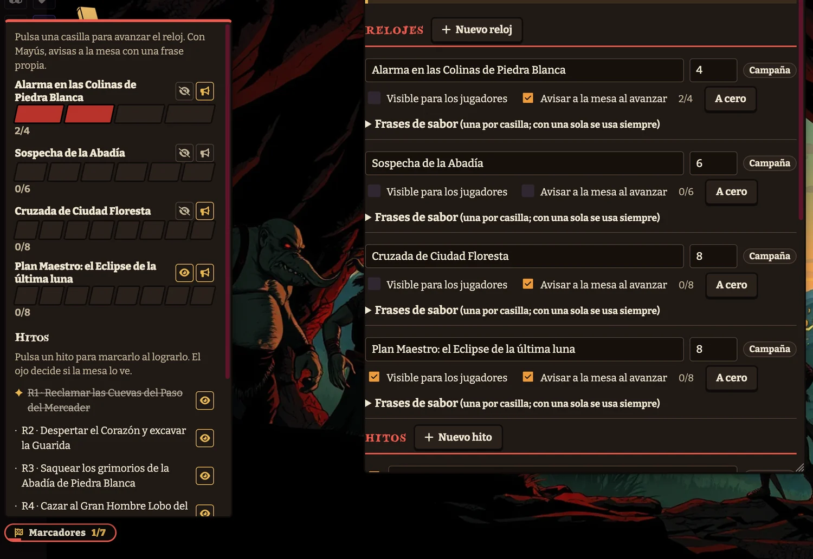</p>

### Experiencia: hitos al final de la sesión
Entre las dos barras de EXP hay un botón **«Fin de sesión»** (también se abre pulsando el nombre de cada barra). Una ventana pregunta, con **Sí / No**, los desencadenantes del manual —plan maestro, escena de otra persona, actuar como un monstruo, uso creativo del equipo— y si interpretaste un desate o un reventado; al anotarlos suben solas la EXP malvada y la osada. La pestaña **Gastar** explica qué desbloquea cada barra al llenarse (una capacidad de vocación, un punto de acción) y cómo funciona la práctica.

<p align="center">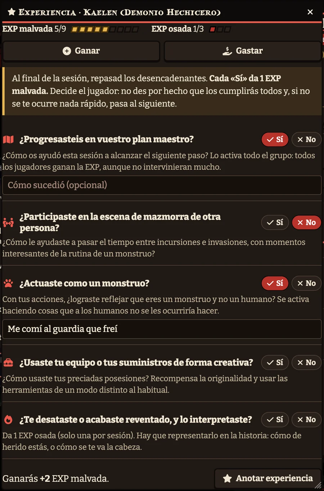</p>

### Una hoja que no estorba
Raza, vocación, impulso y juerga quedan **fijados** una vez elegidos; solo se pueden cambiar activando el **modo evolución** de la barra de la hoja, y las capacidades nuevas se ofrecen cuando llenas la EXP malvada. Las herramientas (compacta, libretos, evolución, aspecto, ayuda, creador) viven en una **barra flotante de cristal** que se muestra u oculta con la calavera. Cada capacidad dice **cómo se usa** (cuesta estrés, pasiva, tiene tirada…) y tiene su botón de uso; las **conmociones, reventado y desatado** salen en un panel de estados; la EXP de práctica solo aparece donde se puede ganar.

### Una hoja limpia: sin cajas y con las herramientas en la barra de la ventana
Los iconos (compacta, libretos, evolución, heridas, recuperación, creador, aspecto, ayuda) viven en la **barra de la ventana**, que se esconde y aparece al acercar el cursor, así la ficha se ve limpia. Las constantes vitales forman una sola banda y las heridas se resumen en **tres gotas crecientes** con el texto del nivel; al pulsarlas se abre su ventana.

<p align="center">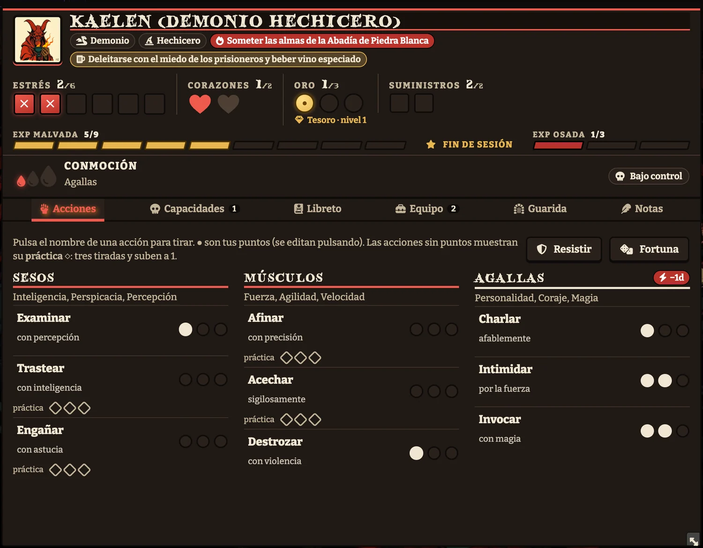 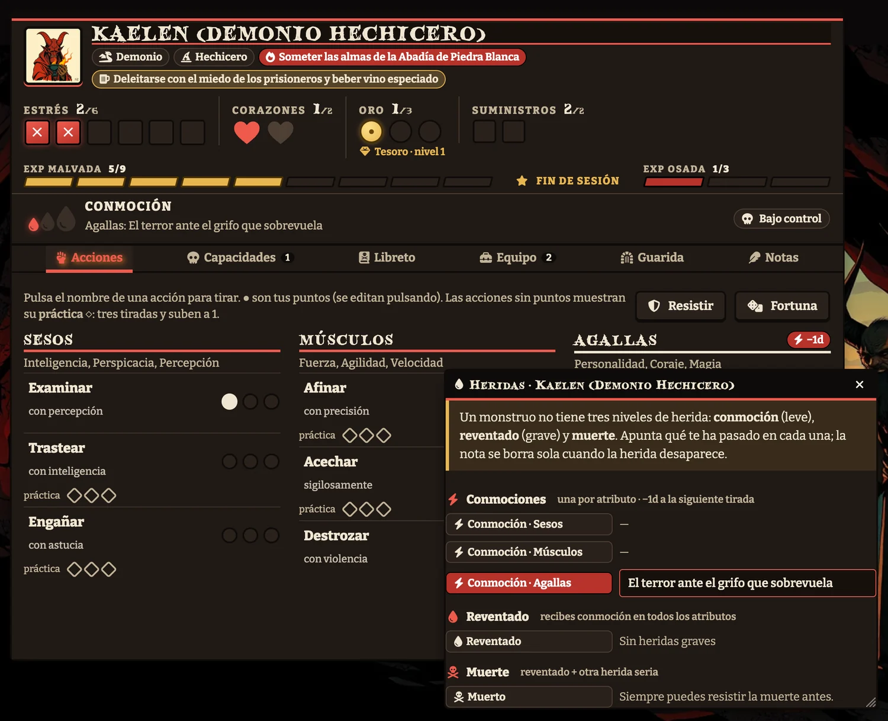</p>

### Heridas que se apuntan, y recuperación
Un monstruo no tiene tres niveles de herida: sufre **conmociones** (leves, una por atributo), puede quedar **reventado** y, si recibe otra herida seria, **muere**. El panel de **Heridas** deja anotar qué te ha pasado en cada una (se borra sola al curarse), reventarse pone conmoción en todos los atributos, y la **recuperación** (botón de la barra de la hoja, o al pasar el ciclo a la fase 1) elimina estrés y heridas y regenera defensas y suministros. La barra de herramientas **aparece al acercar el cursor**.

### Catálogo de objetos con buscador
Añadir equipo, suministros, defensas, proyectos, labores, mejoras y aventureros abre un **catálogo** con búsqueda, categorías (armas y armaduras, mejunjes, artilugios, pociones, objetos mágicos…), orden alfabético y la descripción de cada objeto. Los nombres de los objetos ya no llevan prefijos de tabla.

### Dados propios y Dice So Nice
Caras de color de menos a más —con el emblema del Señor Oscuro en el 6— en las **tarjetas del chat** y, si tienes [Dice So Nice](https://foundryvtt.com/packages/dice-so-nice), también en los **dados 3D** (ajuste «Dados de Wicked Ones»; cada jugador puede cambiarlos en su configuración de dados).

### Ayuda al detener el cursor
Si dejas el cursor **quieto dos segundos** sobre cualquier botón, casilla o dato de las hojas y las tarjetas, un globo explica qué es y cómo se usa (el retraso se ajusta de 0,5 a 5 s o se desactiva).

### Una hoja de monstruo pensada para jugar
Cabecera y **constantes vitales siempre visibles**: el **Estrés** se marca pulsando sus casillas (y al llenarlo el personaje se desata), igual que los corazones oscuros, el oro, los suministros y la EXP. El resto, repartido en pestañas: **Acciones**, **Capacidades**, **Libreto**, **Equipo**, **Guarida** y **Notas**. Nada de una hoja enorme en una sola pestaña.

<p align="center"> 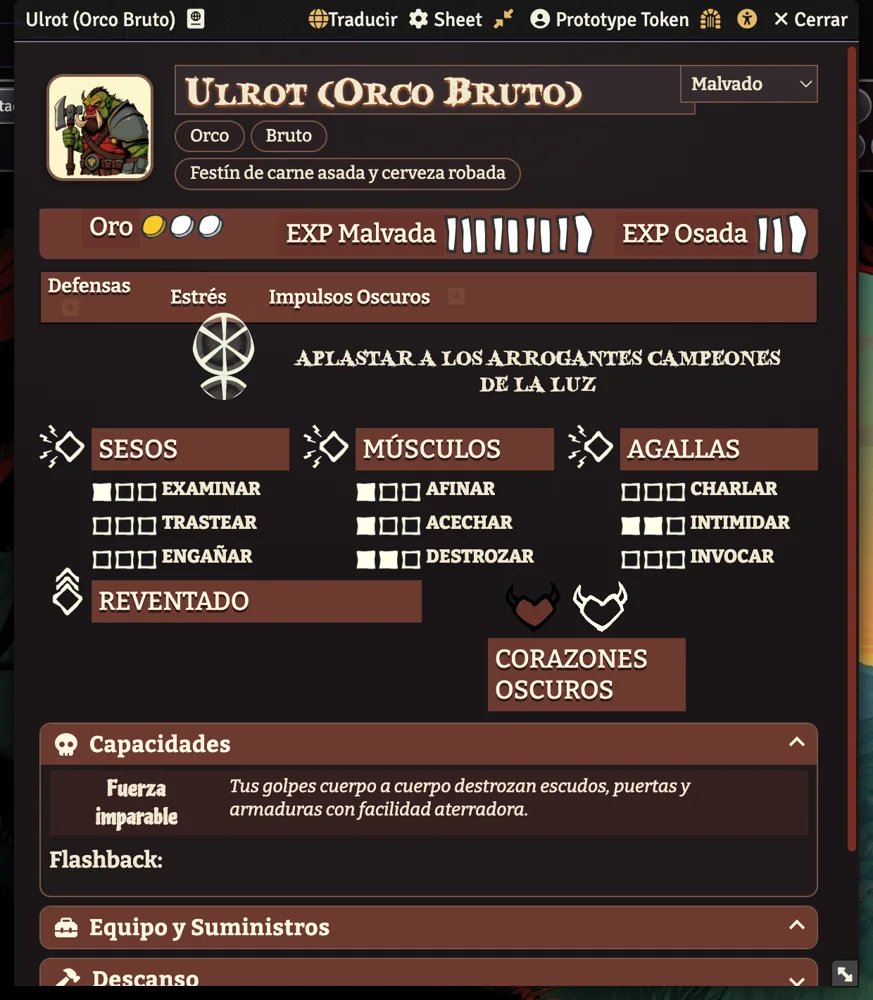</p>

El **modo compacto** deja solo lo habitual (vitales, acciones y capacidades) en un rincón de la pantalla; recuerda tamaño y posición de cada hoja.

### Todas las hojas, rediseñadas
Además de la de personaje, ahora tienen hoja propia: **manada de esbirros**, **mazmorra**, **facción** (y la de la Alianza Impía), **grupo invasor** (con corazones tachables y defensas), **panel del DJ** (el ciclo de juego de un vistazo con las pistas de cada fase), **conquista** y **reloj** (con su círculo). El **despertado** usa la misma hoja de monstruo, con su «Anatomía», «Secreciones/Trofeos» y pestaña de «Conquista».

<p align="center">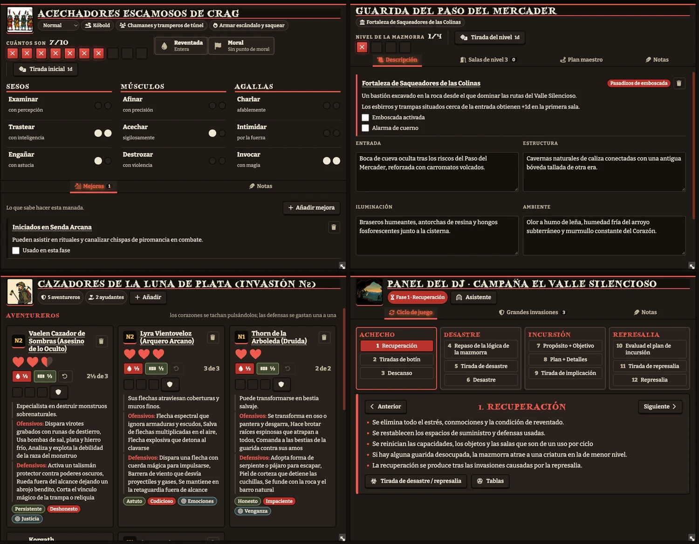</p>

### Libretos: qué eres y cómo interpretarlo
Los jugadores ven su **vocación** y su **raza** explicadas —cómo interpretarlas, capacidad principal, pista de *flashback*, todas las capacidades que pueden aprender (con botón para añadirlas a la hoja), objetos de ejemplo, frases y nombres típicos— y los **impulsos oscuros** y **juergas**. Están en la pestaña *Libreto* de la hoja y en la ventana **Libretos** (cabecera de la hoja, o `api.abrirLibretos()`).

<p align="center">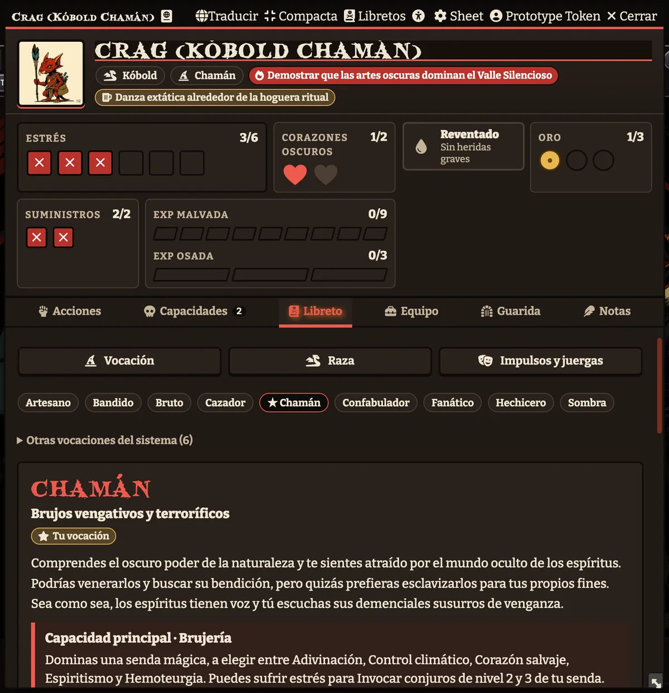</p>

### Tiradas con toque malote
El clic en una acción abre un lanzador inspirado en los lanzadores FitD genéricos, integrado en el módulo: eliges la acción, los **trucos del manual** (*Ayudar*, *Darlo todo*, **pacto oscuro**, **corazón oscuro**), ves la **probabilidad** de fallo/parcial/éxito/crítico y tiras pulsando la casilla donde se cruzan **Situación** y **Efecto**. También sirve para **resistir** (no se puede con la acción que causó la consecuencia) y para tiradas de fortuna.

<p align="center">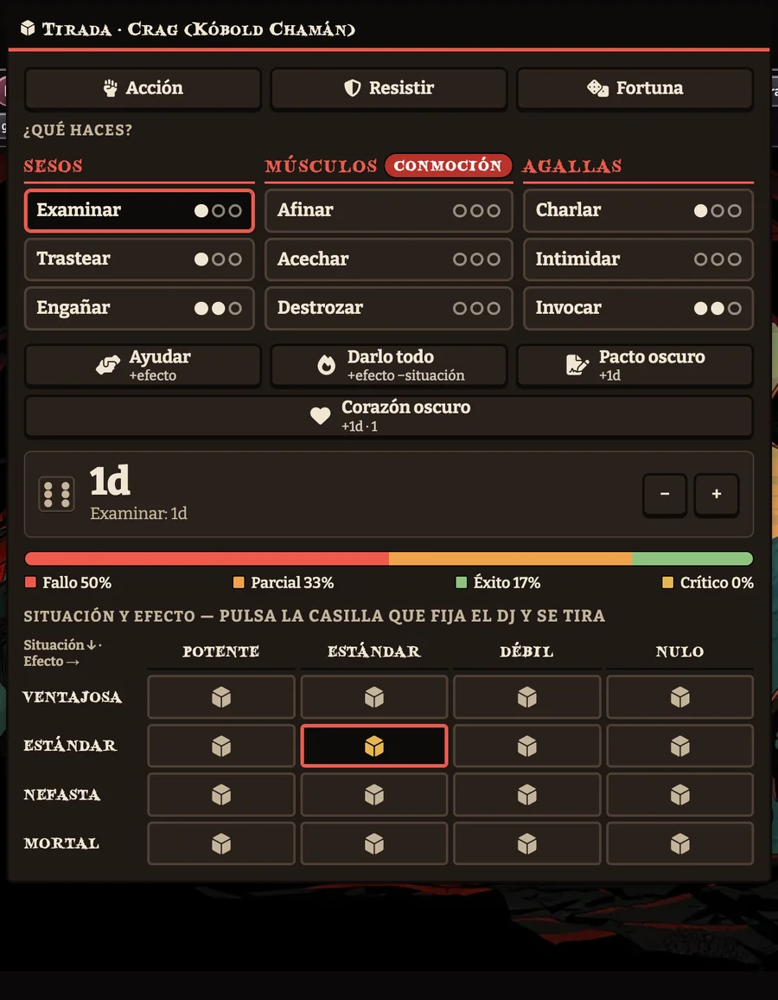 </p>

<p align="center">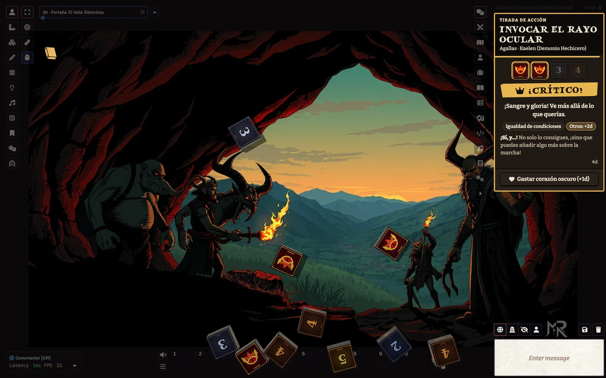</p>

Las **tarjetas del chat** muestran los dados de hueso, el veredicto, la gravedad de la consecuencia según la situación y lo que se aplicó solo; desde ellas se puede **resistir** o **gastar un corazón oscuro** (la tarjeta se recalcula). También las del ciclo de partida, los oráculos y el «¡se desata!».

### Accesibilidad completa
Un panel con vista previa: **modo oscuro** (también en las tarjetas del chat), **alto contraste**, **lectura limpia** con tinta a elegir, **tamaño de texto** (85–160 %), **tipografía sencilla**, **espaciado amplio**, **botones grandes**, **menos movimiento** (respeta el del sistema operativo), **menos efectos** y **marcas para daltonismo**. Se abre desde Configuración o desde la cabecera de la hoja.

<p align="center">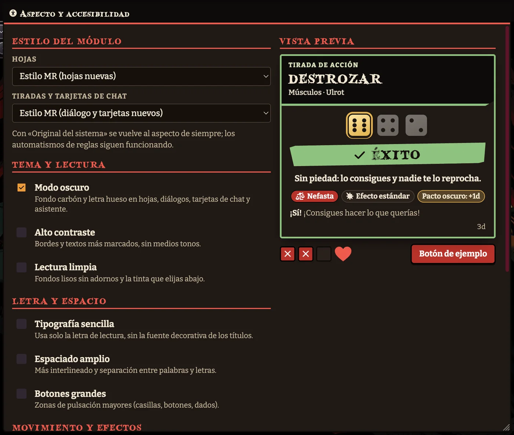</p>

<p align="center">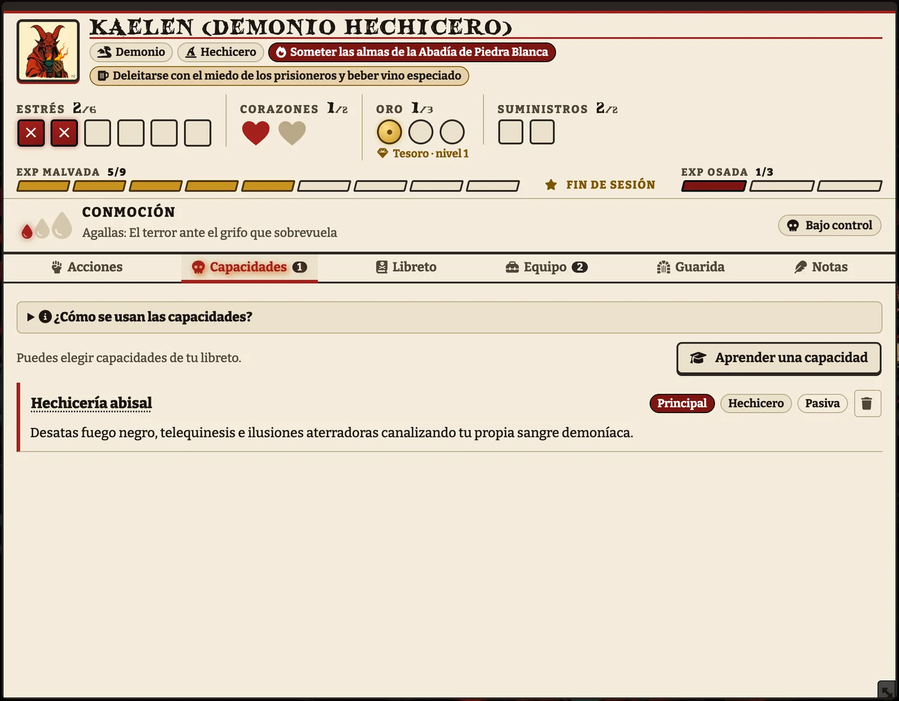</p>

### Todo es opcional
En Configuración, **«Estilo de las hojas»** y **«Estilo de las tiradas y las tarjetas»** se pueden poner en *Original del sistema* para volver al aspecto de siempre (por defecto, MR). Los automatismos de reglas siguen funcionando en cualquier caso.

### Asistente y generador
Solo para la dirección: todas sus tiradas se **susurran al DJ** y traen un botón **«Mostrar a los jugadores»**; cada sección explica para qué sirve (con una guía para quien dirige por primera vez). Rehecho: cinco secciones (**La mesa**, **Esbirros**, **Guarida**, **Invasores**, **Tablas**) con tarjetas claras, labores agrupadas por tipo y tablas con su dado.

<p align="center">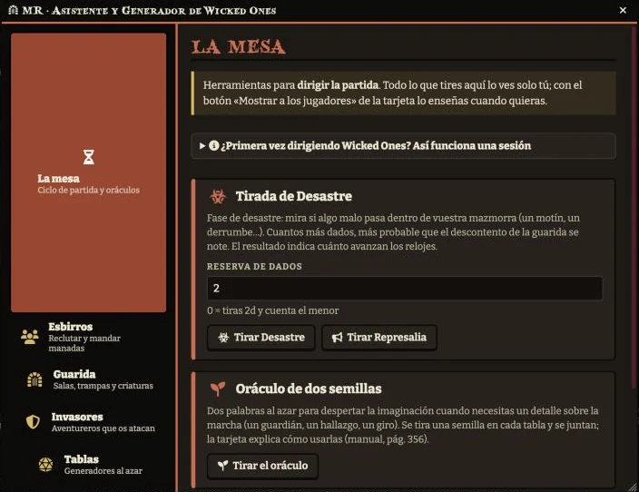 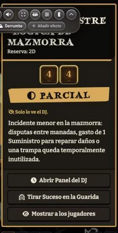</p>

### Reglas automatizadas
Tras cada tirada se aplican solas las reglas del libro (se puede desactivar en Configuración):
- **Resistencias**: fallo 3 de Estrés, parcial 2, éxito 1; el crítico despeja 1.
- **Estrés lleno**: el personaje se **desata** y la tarjeta recuerda los pasos.
- **Conmoción** que se limpia y **EXP de práctica** (tres marcas suben la acción a 1 punto).
- **Corazón oscuro**: se gasta desde la tarjeta o el lanzador, tira +1D y recalcula el resultado (y corrige el Estrés).

### Instalar, actualizar y reinstalar
Al activar el módulo en un mundo vacío, un asistente te deja **importar todo al mundo** o **solo ordenar los compendios**. Al **actualizar**, se te ofrece **reinstalar todo el contenido**: restaura lo que es del módulo, añade lo nuevo y retira lo que ya no existe, **sin tocar nada que no sea del módulo** (también está en Configuración). Un **tutorial guiado** para dirección y para jugadores se repite cuando quieras.

## 📋 Requisitos

| Componente | Notas |
|---|---|
| **Foundry VTT** | v13 (v14 sin probar). |
| **Sistema [Wicked Ones](https://foundryvtt.com/packages/wicked-ones)** | Sistema base. |
| **[Babele](https://foundryvtt.com/packages/babele)** y **[Wicked Ones (Español)](https://foundryvtt.com/packages/wicked-ones-esp)** | Traducción base. |
| **[MR- Dirección](https://github.com/ManuRomera/mr-direccion)** *(recomendado)* | Escenas, música, motivos, figuras y relojes. |

## ⚡ Instalar

En Foundry: **Add-on Modules → Install Module** y pega el manifiesto:

```text
https://github.com/ManuRomera/mr-wicked-ones-es/releases/latest/download/module.json
```

## 🔧 Cómo está hecho

El arte se genera en local con **Flux (Draw Things)** y se procesa con `tools/ingest_arte.py`; la música se sintetiza con `tools/audio.py`; `npm run datos` ensambla los compendios (`_data` → `_pack`) y `npm run build` los compila. El informe de la reescritura está en [`docs/AUDITORIA.md`](docs/AUDITORIA.md).

```bash
npm install
npm test
npm run datos && npm run build
```

## 📜 Créditos y aviso

- **Juego original:** *Wicked Ones*, de **Ben Nielson** (Bandit Camp), CC0. Edición en español: The Hills Press.
- **Sistema:** Spearhead y LorduFreeman. **Traducción base:** wicked-ones-esp.
- **Diseño, arte generado, música, programación y adaptación:** Manu Romera (MR · Digital RPG Design).
- Más en [`NOTICE.md`](NOTICE.md). Licencia MIT para el código.

<p align="center"><sub>MR- · Manu Romera · <a href="https://github.com/ManuRomera">github.com/ManuRomera</a></sub></p>

---

## 🇬🇧 English summary

**MR- Wicked Ones** extends the [Wicked Ones](https://foundryvtt.com/packages/wicked-ones) system for Foundry VTT (v13) with a complete Spanish-language campaign (*El Valle Silencioso*), all-new art generated locally in the Wicked Ones style, and the usual MR- toolkit:

- **Everything in folders**: actors, items, scenes, journals and compendia, with this module's content separated from the system's.
- **Redesigned character sheet**: vitals always visible (clickable stress track), tabs for Actions, Abilities, **Playbook**, Gear, Lair and Notes, and a real compact mode.
- **Step-by-step character creator** following the rulebook order, with a *Random* button on every step and a one-click *Randomise everything*.
- **Locked playbook choices** (race, calling, impulse, revelry) unless you switch on *evolution mode*; clear ability usage badges and use buttons; shock / bloodied / feral states panel; glass-style floating toolbar.
- **Searchable item catalogue** (categories, alphabetical, descriptions) instead of the system's long dropdown, and **wound ± controls** for adventurers.
- **Custom dice** (colour-scaled faces, Dark Lord emblem on the 6) in chat cards and in **Dice So Nice**.
- **Wounds you can annotate** (shock → bloodied → dead), a **Recovery** button and prompt on cycle phase 1, and a toolbar that appears on hover.
- **GM-only assistant** (whispered rolls with a *Show to players* button and explanations), **box-free sheet** with the toolbar in the window bar (shows on hover) and a wounds window.
- **Dungeon-Keeper-style dungeon builder**: dig tunnels and build ten kinds of rooms by dragging a rectangle; each room fits itself to the space (growing to its minimum), has its own layout turned toward its door (carpets follow the door axis), and corridors get torches drawn front-on or side-on depending on direction. Rooms can have any shape (oval, L, cross, freehand). Tiny minions wander the dungeon (density set by the GM and tied to dungeon level) and can be whipped into working twice as fast; sound effects and cave ambience (toggleable) accompany every action; rulebook traps and tricks can be placed and rolled, the GM can grant extra rest actions, and tokens shrink to half a cell in dungeon scenes. It follows the rulebook (toggleable): rest-action budget per stalk phase, level-3 rooms need the theme and materials from the dungeon sheet. Walls, doors and torch-animated lights are native Foundry documents; players can build too (via the GM).
- **Native milestones & clocks control** (draggable pill, GM manager with public/secret milestones, hidden/visible clocks, announcements with flavour phrases); it replaces MR- Dirección's and shares its data when that module is active.
- **Session XP window** (yes/no milestones, spending guide).
- **Hover help**: rest the cursor for two seconds on anything and a balloon explains it.
- **Playbooks** for every calling and monster race (how to play it, abilities you can learn, example items), readable by players.
- **Roller** inspired by generic FitD rollers (Position × Effect grid, Help / Go all out / dark pact / dark heart, live odds) and **monster-themed chat cards**.
- **Full accessibility panel** (dark mode also on chat cards, high contrast, reading mode, text size, plain font, spacing, big buttons, less motion/effects, colour-blind marks) and a switch back to the original system look.
- **Scene reading + music + effects** for 21 scenes through [MR- Dirección](https://github.com/ManuRomera/mr-direccion); original synthesized soundtrack.
- **Reinstall content** on update without touching anything that isn't the module's.
- **Automations** verified against the *Wicked Ones* 1.4 rulebook (CC0): resistance stress, feral state, shock, practice XP, Dark Heart +1D; all optional.
- **Guided tour** for the GM and for players, and an install wizard (import everything or just organise the compendia).

Requires the `wicked-ones` system, `babele` and `wicked-ones-esp`. Manifest: `https://github.com/ManuRomera/mr-wicked-ones-es/releases/latest/download/module.json`. Foundry v14 is untested.
