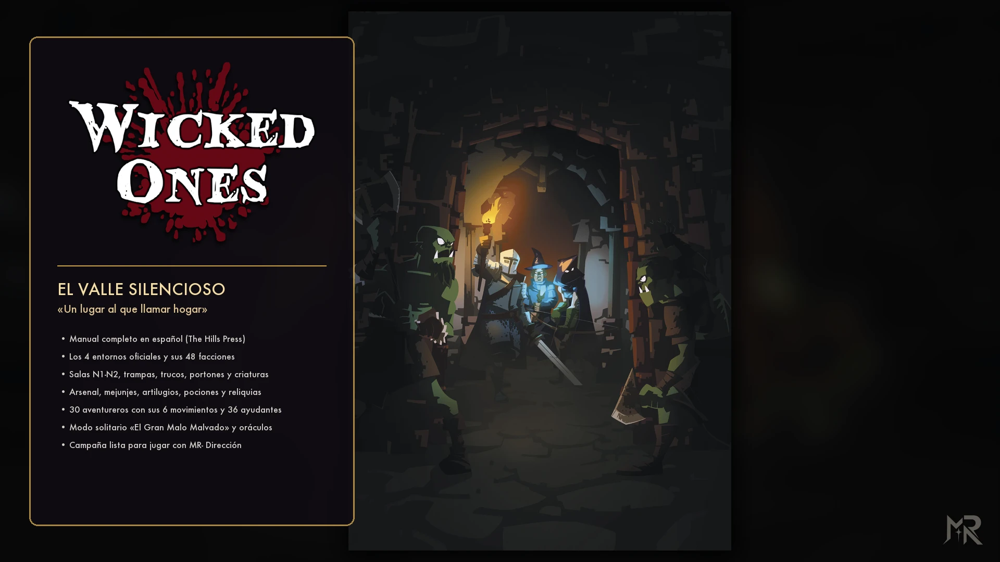
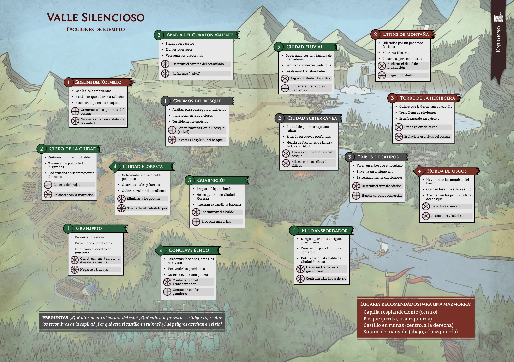
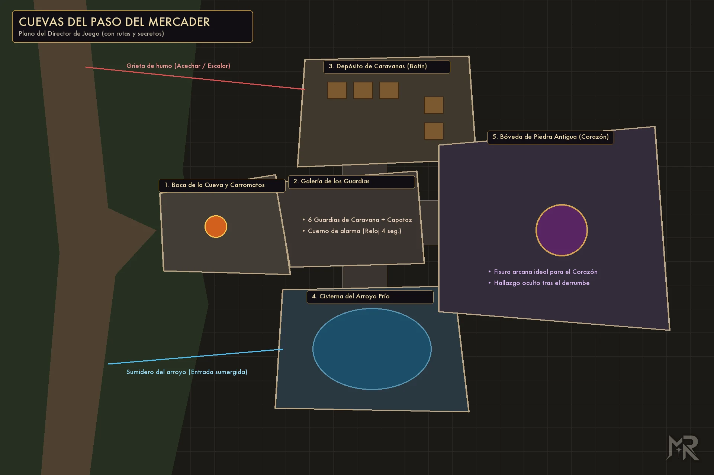
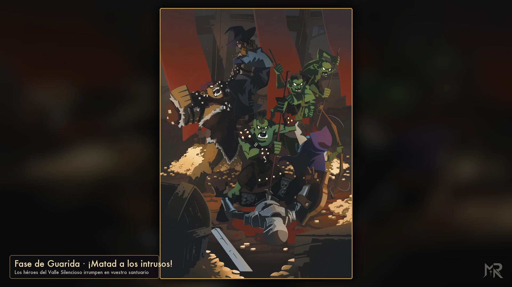

<p align="center">
  
</p>

<p align="center">
  <a href="https://github.com/ManuRomera"></a>
  <a href="https://github.com/ManuRomera/mr-wicked-ones-es/releases/latest"></a>
  
  <a href="https://github.com/ManuRomera/mr-wicked-ones-es/releases"></a>
  
  
  <a href="LICENSE"></a>
</p>

<h3 align="center">El contenido íntegro que faltaba en Foundry VTT para la edición en español de <em>Wicked Ones</em> (The Hills Press), junto con la campaña lista para jugar «El Valle Silencioso».</h3>

> [!IMPORTANT]
> Este módulo amplía el sistema [**Wicked Ones**](https://foundryvtt.com/packages/wicked-ones) y su traducción [**Wicked Ones (Español)**](https://github.com/Billy-Blade/wicked-ones-esp) con **Babele**. Para disfrutar de la barra del Director de Juego, las lecturas en voz alta, los relojes de facción en pantalla y las figuras de cuerpo entero a escala en la campaña, instala también [**MR- Dirección**](https://github.com/ManuRomera/mr-direccion).

<p align="center">
  <a href="https://github.com/ManuRomera/mr-wicked-ones-es/releases/latest/download/module.zip"><strong>⬇️ Descargar última versión</strong></a>
  ·
  <a href="#-instalar"><strong>⚡ Instalar</strong></a>
  ·
  <a href="#-qué-trae-el-módulo"><strong>📦 Contenido</strong></a>
  ·
  <a href="#-cómo-empezar"><strong>🏰 Cómo empezar</strong></a>
</p>

---

## 🏰 La premisa

Sois **Malvados** —caudillos de guerra, hechiceros oscuros, fanáticos, cerebros criminales y brutos monstruosos— excavando vuestra propia guarida bajo la montaña mientras los autoproclamados «héroes» de la superficie os persiguen.

El sistema oficial de *Wicked Ones* para Foundry VTT y su traducción inicial solo incluían los arquetipos básicos, poderes y esbirros, dejando fuera **más de 400 elementos del manual de The Hills Press**: las salas de mazmorra N1–N2, trampas, trucos, cerraduras, criaturas de guarida, mejunjes, artilugios, pociones, objetos mágicos, los **6 movimientos individuales de cada uno de los 30 aventureros**, los 36 ayudantes, los **4 entornos de campaña con sus 48 facciones**, las tablas de botín y calamidades, el modo en solitario **«El Gran Malo Malvado»** y una aventura lista para abrir mesa. **MR- Wicked Ones** incorpora todo ese material, corrige traducciones pendientes, añade un generador interactivo de incursiones y mazmorra y despliega la campaña completa **«El Valle Silencioso: Un lugar al que llamar hogar»**.

<p align="center">
  
  
</p>

<p align="center">
  
  
</p>

---

## 📦 Qué trae el módulo

Al activar **MR- Wicked Ones: Contenido Completo y Campaña** en un mundo vacío, la aventura se importa sola y activa la escena de portada. Todos los recursos quedan también disponibles en 7 compendios en español:

| Recurso | Detalle |
|---|---|
| **Salas, Trampas, Trucos y Criaturas (`labores-es`)** | **130 elementos de guarida**: las 18 salas de Nivel 1, 18 salas de Nivel 2, 20 trampas, 14 trucos, 12 cerraduras y portones, 36 criaturas de guarida (N1–N3) y 12 descubrimientos subterráneos con costes y reglas exactas. |
| **Arsenal, Alquimia, Artilugios y Magia (`equipo-es`)** | **165 objetos**: armas, armaduras y suministros, los 36 mejunjes alquímicos, los 36 artilugios goblinoides, las 36 pociones (N1–N3), los 36 objetos mágicos (N1–N3) y proyectos de ritual. |
| **30 Aventureros Completos y 36 Ayudantes (`aventureros-es`)** | Los **30 arquetipos de aventureros** con sus rasgos, motivaciones, pasiva y sus **6 movimientos individuales** (3 ofensivos + 3 defensivos) en español e ilustración propia, más los **36 ayudantes y mercenarios** de los 6 gremios y cultos. |
| **4 Entornos y 48 Facciones (`facciones-es`)** | Los 4 entornos del libro (*El Valle Silencioso*, *Las Cloacas de Cantoclaro*, *Los Mares de Sharn* y *La Guerra por el Trono*) con sus **48 facciones** completas, más **6 PJ pregenerados**, **6 manadas de esbirros**, el actor de la **Mazmorra** y **4 grupos de aventureros rivales**. |
| **16 Tablas y Oráculos (`tablas-es`)** | Tablas de botín (N1–N3), eventos de incursión, calamidades de guarida, nombres y apodos monstruosos, generador de aventureros rivales y los **5 oráculos completos del modo en solitario «El Gran Malo Malvado»**. |
| **Manual y Referencia (`manual-es`)** | **10 diarios multipágina** con guía de inicio («Empieza aquí»), referencia rápida de fases, los **13 Dioses Oscuros** ilustrados, catálogo de salas y trampas, alquimia y magia, los 4 entornos de campaña y las reglas completas del modo en solitario y sin DJ. |
| **Campaña «El Valle Silencioso» (`aventura-es`)** | **15 escenas** (portada, los 4 mapas regionales en versión mesa y DJ, planos tácticos de las *Cuevas del Paso del Mercader* en versión mesa sin secretos y versión DJ con rutas y etiquetas, los 3 niveles de guarida y 4 escenas ilustradas de incursión, defensa, consejo de guerra y ritual), actores con retrato, token redondo y **figura de cuerpo entero**, y paquete preconfigurado para **MR- Dirección**. |
| **Generador, Chat y Accesibilidad** | **Generador y Oráculo del Señor Oscuro** (`ConMemoria`), tarjetas de chat enriquecidas con botones de confirmación (`Consecuencia`, `Reloj +1/+2/+3`, `Estrés`, `Tirar botín`), traducción reactiva de textos fijos del sistema y modo oscuro/accesibilidad compartido con el ecosistema `MR-`. |

---

## 📋 Requisitos

| Componente | Notas |
|---|---|
| **Foundry VTT** | **v13** o **v14** (código unificado mediante `js/compat.mjs`). |
| **Sistema [Wicked Ones](https://foundryvtt.com/packages/wicked-ones)** | Sistema base Forged in the Dark para *Wicked Ones*. |
| **[Babele](https://foundryvtt.com/packages/babele)** y **[Wicked Ones (Español)](https://github.com/Billy-Blade/wicked-ones-esp)** | Para la traducción base de arquetipos y poderes sobre la que este módulo aplica sus parches y compendios adicionales. |
| **[MR- Dirección](https://github.com/ManuRomera/mr-direccion)** *(recomendado)* | Para mostrar las escenas ilustradas a toda pantalla, colocar figuras de cuerpo entero a escala y manejar los relojes del Valle Silencioso desde la barra inferior. |

---

## ⚡ Instalar

### Desde Foundry VTT (recomendado)

1. En Foundry, ve a **Add-on Modules → Install Module**.
2. En **Manifest URL**, pega:
   ```text
   https://github.com/ManuRomera/mr-wicked-ones-es/releases/latest/download/module.json
   ```
3. Pulsa **Install**.

### Manual

Descarga [`module.zip`](https://github.com/ManuRomera/mr-wicked-ones-es/releases/latest/download/module.zip) de la última versión y descomprímelo dentro de `Data/modules/mr-wicked-ones-es/`.

---

## 🏰 Cómo empezar

1. Crea un mundo con el sistema **Wicked Ones**.
2. En **Manage Modules**, activa **Babele**, **Wicked Ones (Español)**, **MR- Dirección** y **MR- Wicked Ones: Contenido Completo y Campaña (The Hills Press)**.
3. Al entrar por primera vez, el módulo importa automáticamente la campaña **«El Valle Silencioso: Un lugar al que llamar hogar»**, activa la escena de portada y abre el diario **«00 · Empieza aquí — El Valle Silencioso»**.
4. Usa el botón de los controles de escena (o la macro incluida) para abrir el **Generador y Oráculo del Señor Oscuro** en cualquier momento de la partida.

---

## 🔧 Cómo está hecho

Los datos fuente viven en JSON determinista (`_data/*.json`) generados desde `tools/datos_reglas.py` y `tools/build_foundry.py`; el artefacto gráficos se extrae y marca con `tools/extract_assets.py` y `tools/banner.py`, y los compendios LevelDB se compilan con `scripts/build.mjs`. La lógica pura de dados, oráculos y generadores está aislada en `js/core/reglas.mjs` y cubierta por tests (`npm test`).

```bash
npm install
npm test                   # ejecuta los tests unitarios del núcleo puro (node --test)
python3 tools/build_foundry.py
npm run build              # compila _data/*.json -> packs/* y genera dist/module.zip
```

---

## 📜 Créditos y aviso

- **Juego original:** *Wicked Ones*, de **Ben Nielson** (**Bandit Camp**), publicado bajo licencia CC BY 4.0.
- **Edición en español:** **The Hills Press**.
- **Diseño, programación, generador, campaña y adaptación a Foundry VTT:** Manu Romera (MR · Digital RPG Design).
- **Licencia:** MIT para el código del módulo. Consulta [`NOTICE.md`](NOTICE.md) y [`LICENSE`](LICENSE) para el detalle completo.

<p align="center">
  <sub>MR- · Manu Romera · <a href="https://github.com/ManuRomera">github.com/ManuRomera</a></sub>
</p>
