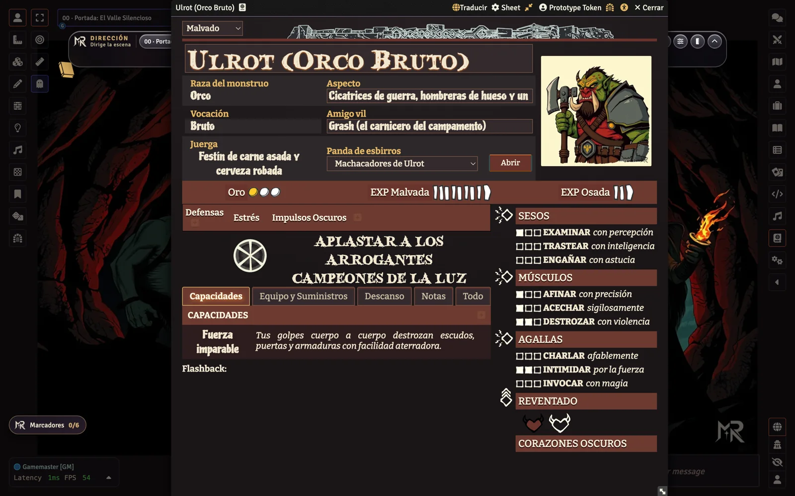

<p align="center">
  
</p>

<p align="center">
  <a href="https://github.com/ManuRomera"></a>
  <a href="https://github.com/ManuRomera/mr-wicked-ones-es/releases/latest"></a>
  
  <a href="https://github.com/ManuRomera/mr-wicked-ones-es/releases"></a>
  
  
  <a href="LICENSE"></a>
</p>

<h3 align="center">Lo que le falta al sistema <em>Wicked Ones</em> en Foundry VTT: campaña, compendios, arte propio, ficha compacta, modo oscuro y reglas automatizadas.</h3>

> [!IMPORTANT]
> Este módulo amplía el sistema [**Wicked Ones**](https://foundryvtt.com/packages/wicked-ones) y su traducción [**Wicked Ones (Español)**](https://foundryvtt.com/packages/wicked-ones-esp) con **Babele**. Para la barra del Director de Juego (escenas, música, relojes) instala también [**MR- Dirección**](https://github.com/ManuRomera/mr-direccion).

<p align="center">
  <a href="https://github.com/ManuRomera/mr-wicked-ones-es/releases/latest/download/module.zip"><strong>⬇️ Descargar</strong></a>
  ·
  <a href="#-instalar"><strong>⚡ Instalar</strong></a>
  ·
  <a href="#-qué-trae"><strong>📦 Contenido</strong></a>
  ·
  <a href="#-mejoras-de-juego"><strong>🛠️ Mejoras</strong></a>
</p>

---

## 🏰 La premisa

Sois **monstruos** —orcos, goblins, kóbolds, demonios, serpientes— que excavan su guarida bajo la montaña mientras los «héroes» de la superficie os persiguen. Este módulo trae el contenido que el sistema no incluye, ordenado y con arte propio en el estilo gráfico del juego.

<p align="center">
  
</p>

## 📦 Qué trae

Todo está en carpetas, y los compendios del sistema quedan separados de los de este módulo.

| Compendio | Contenido |
|---|---|
| **Campaña** | «El Valle Silencioso»: 21 escenas ilustradas y mapas, con **lectura**, **música** y **efectos**; listas de reproducción; macros. |
| **Libro y referencia** | Diarios por capítulos, «Empieza aquí» y las lecturas de escena. |
| **Tablas** | Botín N1–N3, incursiones, calamidades, nombres y el modo solitario «El Gran Malo Malvado». |
| **Aventureros y ayudantes** | 30 aventureros con sus 6 movimientos y 36 ayudantes, cada uno con retrato. |
| **Salas, trampas, trucos, portones y criaturas** | 130 elementos de guarida con icono propio. |
| **Equipo** | 165 objetos: arsenal, 36 mejunjes, 36 artilugios, 36 pociones y 36 reliquias, todos con icono. |
| **Personajes · Esbirros · Facciones · Grupos** | 6 pregenerados, 6 manadas, 48 facciones de 4 entornos y grupos rivales, con retrato, token y figura de cuerpo entero. |

<p align="center">
  
</p>

## 🛠️ Mejoras de juego

### Ficha compacta
Reúne en una sola vista lo habitual —retrato, EXP, estrés, defensas y los tres atributos— y deja capacidades, equipo y labores en secciones plegables que se pueden tener abiertas a la vez. Recuerda tamaño, posición y secciones de cada ficha.

<p align="center"></p>

### Modo oscuro que se ve
Los indicadores negros del sistema (casillas de habilidad, conmoción, reloj de estrés, corazones) se recolorean en oscuro. Se activa desde el icono de accesibilidad de la cabecera.

<p align="center"></p>

### Reglas automatizadas
Tras cada tirada se aplican solas las reglas del libro (se puede desactivar en Configuración):
- **Resistencias**: fallo 3 de Estrés, parcial 2, éxito 1; el crítico despeja 1.
- **Estrés lleno**: el personaje se **desata** y la tarjeta recuerda los pasos.
- **Conmoción** que se limpia y **EXP de práctica** (tres marcas suben la acción a 1 punto).
- **Corazón Oscuro**: un botón gasta uno, tira +1D y recalcula el resultado.

### Asistente de instalación y tutorial
Al activar el módulo en un mundo vacío, un asistente te deja **importar todo al mundo** o **solo ordenar los compendios**. Después, un **tutorial guiado** para dirección y para jugadores. Ambos se repiten desde Configuración.

## 📋 Requisitos

| Componente | Notas |
|---|---|
| **Foundry VTT** | v13 (v14 sin probar). |
| **Sistema [Wicked Ones](https://foundryvtt.com/packages/wicked-ones)** | Sistema base. |
| **[Babele](https://foundryvtt.com/packages/babele)** y **[Wicked Ones (Español)](https://foundryvtt.com/packages/wicked-ones-esp)** | Traducción base. |
| **[MR- Dirección](https://github.com/ManuRomera/mr-direccion)** *(recomendado)* | Escenas, música, motivos, figuras y relojes. |

## ⚡ Instalar

En Foundry: **Add-on Modules → Install Module** y pega el manifiesto:

```text
https://github.com/ManuRomera/mr-wicked-ones-es/releases/latest/download/module.json
```

## 🔧 Cómo está hecho

El arte se genera en local con **Flux (Draw Things)** y se procesa con `tools/ingest_arte.py`; la música se sintetiza con `tools/audio.py`; `npm run datos` ensambla los compendios (`_data` → `_pack`) y `npm run build` los compila. El informe de la reescritura está en [`docs/AUDITORIA.md`](docs/AUDITORIA.md).

```bash
npm install
npm test
npm run datos && npm run build
```

## 📜 Créditos y aviso

- **Juego original:** *Wicked Ones*, de **Ben Nielson** (Bandit Camp), CC0. Edición en español: The Hills Press.
- **Sistema:** Spearhead y LorduFreeman. **Traducción base:** wicked-ones-esp.
- **Diseño, arte generado, música, programación y adaptación:** Manu Romera (MR · Digital RPG Design).
- Más en [`NOTICE.md`](NOTICE.md). Licencia MIT para el código.

<p align="center"><sub>MR- · Manu Romera · <a href="https://github.com/ManuRomera">github.com/ManuRomera</a></sub></p>

---

## 🇬🇧 English summary

**MR- Wicked Ones** extends the [Wicked Ones](https://foundryvtt.com/packages/wicked-ones) system for Foundry VTT (v13) with a complete Spanish-language campaign (*El Valle Silencioso*), all-new art generated locally in the Wicked Ones style, and the usual MR- toolkit:

- **Everything in folders**: actors, items, scenes, journals and compendia, with this module's content separated from the system's.
- **Real compact sheet** (not a crop): header, counters, defences/stress, attributes and collapsible sections regrouped in one place; remembers size, position and open sections per sheet.
- **Fixed dark mode** (black PNG indicators recoloured so they stay visible).
- **Scene reading + music + effects** for 21 scenes through [MR- Dirección](https://github.com/ManuRomera/mr-direccion); original synthesized soundtrack.
- **Automations** verified against the *Wicked Ones* 1.4 rulebook (CC0): resistance stress, feral state, shock, practice XP, Dark Heart +1D; all optional.
- **Guided tour** for the GM and for players, and an install wizard (import everything or just organise the compendia).

Requires the `wicked-ones` system, `babele` and `wicked-ones-esp`. Manifest: `https://github.com/ManuRomera/mr-wicked-ones-es/releases/latest/download/module.json`. Foundry v14 is untested.
